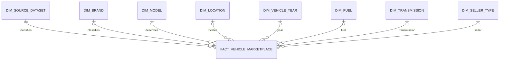
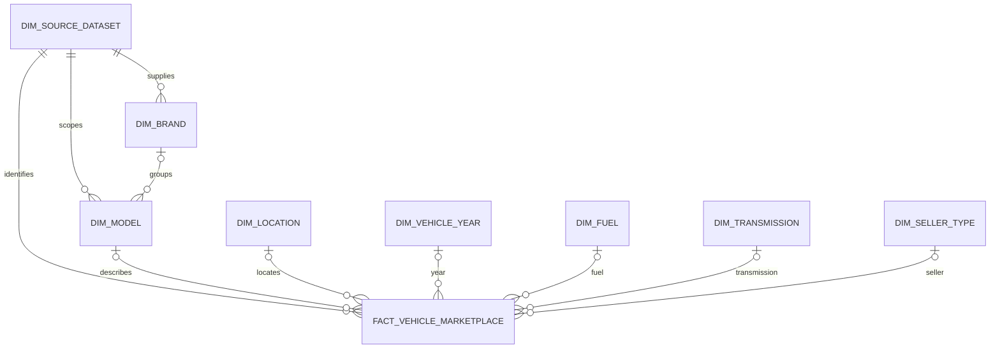

# Data Warehouse Design

## Status and scope

This is a PostgreSQL design proposal only. No database schemas, tables, SQL
migrations, or data loads have been created. The design is based on
`backend/etl/dataset_inspection_report.md` and
`backend/etl/etl_strategy.md`; those reports contain the detailed profiling
results.

## Fact grain

`FACT_VEHICLE_MARKETPLACE` contains **one accepted source vehicle record from
one source dataset**. It does not assert that a record is a completed sale, a
unique physical vehicle, or a dated transaction. Repeated records remain
separate until a source-specific identity and duplicate policy are established.

There is no transaction-date key: none of the CSVs supplies a transaction
date, and vehicle year or age is not a substitute.

## Source-to-warehouse mapping

| Input and source group | Proposed treatment |
| --- | --- |
| `combined_cars.csv`, `Source.Name = car data.csv` (301 rows) | Candidate fact records after validation. Map `Car_Name`, `Year`, `Kms_Driven`, `Fuel_Type`, `Seller_Type`, `Transmission`, and `Owner`. Retain `Selling_Price` and `Present_Price` in separate raw-price columns. No brand is supplied. |
| `combined_cars.csv`, other `Source.Name` groups | **Pending.** Their values do not match the flattened file's declared schema (some groups have no populated declared fields; another populates only `Year` and `Transmission`). Recover each original header and field mapping before loading. |
| `combined_cars2.csv`, `Source.Name = Dataset.csv` (1,725 rows) | Candidate fact records after validation. Map `brand`, `model_name`/`full_model_name`, `year`, `price`, `distance_travelled(kms)`, `fuel_type`, and observed `city`. Preserve `Id` and the unnamed index-like field with their original labels where recorded (`Column1` or blank in the embedded header); `Source_Row_Index` is only an inspection-script label. Derived rank, inverse, standardized, flag, and buy-score columns are excluded until their definitions are verified. |
| `combined_cars2.csv`, `Source.Name` groups beginning `UsedCars_` | **Pending.** Eight header-like rows and shifted/narrower layouts make the global 24-column interpretation unreliable. Recover each subgroup's actual header and row alignment first; do not map the apparent `price`, `year`, or other shifted values. |
| `combined_cars3.csv`, `Source.Name = cardekho_dataset.csv` (15,411 rows) | Candidate fact records after validation. Map `brand`, `car_name`/`model`, `fuel_type`, `transmission_type`, `seller_type`, `km_driven`, `vehicle_age`, `mileage`, `engine`, `max_power`, `seats`, and `selling_price`. `vehicle_age` is age, not model year. Preserve the unnamed index-like field with its original label (`Column1` or blank in the embedded header) after validation; `Source_Row_Index` is only an inspection-script label. |

The shared field concepts are candidates, not an instruction to merge source
labels. Model and brand values remain source-scoped until their vocabularies
are reconciled. The current price ranges are not evidence of common units or
currency; the apparent price measure and its original value remain separate
for each source field.

## Dimensions supported by the sources

These are logical definitions to be created separately in the `STAR` and
`SNOWFLAKE` PostgreSQL schemas.

| Dimension | Proposed columns and constraints | Source support |
| --- | --- | --- |
| `DIM_SOURCE_DATASET` | `source_dataset_key BIGINT PK`; `container_csv_name TEXT NOT NULL`; `source_name_value TEXT NULL`; `UNIQUE (container_csv_name, source_name_value)` | Top-level CSV filename and observed `Source.Name`. |
| `DIM_BRAND` (star) | `brand_key BIGINT PK`; `source_dataset_name TEXT NOT NULL`; `brand_name_raw TEXT NOT NULL`; `UNIQUE (source_dataset_name, brand_name_raw)` | `brand` in the recoverable `Dataset.csv` group and `combined_cars3.csv`. Not present in the recoverable `car data.csv` group. |
| `DIM_MODEL` (star) | `model_key BIGINT PK`; `source_dataset_name TEXT NOT NULL`; `source_model_field TEXT NOT NULL`; `model_name_raw TEXT NOT NULL`; `full_model_name_raw TEXT NULL` | `Car_Name`, `model_name`/`full_model_name`, and `car_name`/`model`. Keep source labels distinct; do not assume same-name values identify the same model. |
| `DIM_LOCATION` | `location_key BIGINT PK`; `source_dataset_name TEXT NOT NULL`; `city_name_raw TEXT NOT NULL`; `UNIQUE (source_dataset_name, city_name_raw)` | `city` in the recoverable `Dataset.csv` group only. No state/region column or city-to-region relationship is supported. |
| `DIM_VEHICLE_YEAR` | `vehicle_year_key BIGINT PK`; `vehicle_year SMALLINT NOT NULL UNIQUE` | `Year` in the recoverable `car data.csv` group and `year` in `Dataset.csv`, subject to confirming both mean vehicle year. No year is derived from age. |
| `DIM_FUEL` | `fuel_key BIGINT PK`; `source_dataset_name TEXT NOT NULL`; `fuel_type_raw TEXT NOT NULL`; `UNIQUE (source_dataset_name, fuel_type_raw)` | `Fuel_Type`/`fuel_type` in recoverable source groups. |
| `DIM_TRANSMISSION` | `transmission_key BIGINT PK`; `source_dataset_name TEXT NOT NULL`; `transmission_type_raw TEXT NOT NULL`; `UNIQUE (source_dataset_name, transmission_type_raw)` | `Transmission` in `car data.csv` and `transmission_type` in `combined_cars3.csv`. |
| `DIM_SELLER_TYPE` | `seller_type_key BIGINT PK`; `source_dataset_name TEXT NOT NULL`; `seller_type_raw TEXT NOT NULL`; `UNIQUE (source_dataset_name, seller_type_raw)` | `Seller_Type` in `car data.csv` and `seller_type` in `combined_cars3.csv`. |

Dimension keys are generated surrogate keys. Source labels are retained as
observed; normalization into shared labels requires an explicit mapping, not
case-folding or guessing.

## Shared fact attributes and measures

The fact table in each schema has a generated `vehicle_marketplace_key BIGINT
PK`, the schema-specific dimension foreign keys described below, and these
source/measures columns:

| Column | Type / constraint | Meaning |
| --- | --- | --- |
| `source_file_name` | `TEXT NOT NULL` | One of the three supplied combined CSV filenames. |
| `source_record_ordinal` | `BIGINT NOT NULL`; `UNIQUE (source_file_name, source_record_ordinal)` | One-based record ordinal in that input CSV, excluding its header/preamble rows; a warehouse lineage identifier, not an original source ID. |
| `source_row_identifier_field` | `TEXT NULL` | Original field label for a source ID/index only when the subgroup layout verifies it; keep a blank label `NULL`, not the inspection-script label `Source_Row_Index`. |
| `source_row_identifier_raw` | `TEXT NULL` | Original ID/index value, retained as text without assuming uniqueness. |
| `combined_cars_selling_price_raw` | `NUMERIC NULL` | Original `Selling_Price` value; no unit conversion. |
| `combined_cars_present_price_raw` | `NUMERIC NULL` | Original `Present_Price` value; kept separate from selling price. |
| `combined_cars2_price_raw` | `NUMERIC NULL` | Original `price` value only for rows whose subgroup layout verifies that field. |
| `combined_cars3_selling_price_raw` | `NUMERIC NULL` | Original `selling_price` value; no unit conversion. |
| `odometer_km` | `NUMERIC NULL` | Parsed only from verified source fields explicitly denoting kilometers. |
| `combined_cars2_car_age_raw` | `NUMERIC NULL` | Original `car_age`; age, not a calendar date. |
| `combined_cars3_vehicle_age_raw` | `NUMERIC NULL` | Original `vehicle_age`; kept source-specific. |
| `combined_cars_owner_raw` | `NUMERIC NULL` | Original `Owner` value; not reinterpreted. |
| `combined_cars3_mileage_raw` | `NUMERIC NULL` | Original `mileage`; unit/definition not supplied. |
| `combined_cars3_engine_raw` | `NUMERIC NULL` | Original `engine`; unit/definition not supplied. |
| `combined_cars3_max_power_raw` | `NUMERIC NULL` | Original `max_power`; unit/definition not supplied. |
| `combined_cars3_seats_raw` | `NUMERIC NULL` | Original `seats` value. |

`source_dataset_key` is `BIGINT NOT NULL FK` in both fact tables because the
container CSV is known. Other dimension keys are `BIGINT NULL FK` when a
verified source value is unavailable. Unavailable attributes remain `NULL`;
no unknown/default member is populated with fabricated data. Rows with
unresolved layouts or unparseable required values stay outside the fact table
pending review.

## Star schema

`STAR.FACT_VEHICLE_MARKETPLACE` has a direct nullable FK to each applicable
dimension: `brand_key`, `model_key`, `location_key`, `vehicle_year_key`,
`fuel_key`, `transmission_key`, and `seller_type_key`; `source_dataset_key`
references `STAR.DIM_SOURCE_DATASET`. Each FK targets the correspondingly
named dimension PK in `STAR`. Brand and model are separate, flat dimensions;
the load process must ensure any pair used on one fact row is consistent.
`source_dataset_key` is `BIGINT NOT NULL`; the brand, model, location, year,
fuel, transmission, and seller keys are `BIGINT NULL`.

Each source label and city/model/fuel/transmission/seller descriptor remains
available in its dimension without requiring a join to another descriptive
dimension. The source-dataset dimension preserves the nested `Source.Name`
along with its container CSV name.

In this diagram and the next, each dimension-to-fact relationship represents
an FK in the fact table. `source_dataset_key` is required; the descriptive
dimension FKs are nullable when the source value is unavailable.

## Snowflake schema

`SNOWFLAKE.FACT_VEHICLE_MARKETPLACE` retains the shared lineage and measure
columns, `source_dataset_key` and `model_key`, and direct FKs to
`DIM_LOCATION`, `DIM_VEHICLE_YEAR`, `DIM_FUEL`, `DIM_TRANSMISSION`, and
`DIM_SELLER_TYPE`. It does **not** carry `brand_key`; brand is reached through
the model hierarchy.
`source_dataset_key` is `BIGINT NOT NULL`; each other fact FK is a nullable
`BIGINT`. Enforce individual FKs for `source_dataset_key` and `model_key`, plus
`FOREIGN KEY (model_key, source_dataset_key)` to the matching unique pair in
`DIM_MODEL` so a model cannot be paired with a different source dataset.

`SNOWFLAKE.DIM_SOURCE_DATASET` and the non-hierarchical dimensions have the
columns and PKs described above, separately instantiated in this schema.
Normalized brand/model tables are:

- `DIM_BRAND`: `brand_key BIGINT PK`, `source_dataset_key BIGINT NOT NULL FK`
  to `DIM_SOURCE_DATASET`, `brand_name_raw TEXT NOT NULL`;
  `UNIQUE (source_dataset_key, brand_name_raw)` and a matching composite
  unique key `(brand_key, source_dataset_key)`.
- `DIM_MODEL`: `model_key BIGINT PK`, `source_dataset_key BIGINT NOT NULL FK`
  to `DIM_SOURCE_DATASET`, `brand_key BIGINT NULL`, `source_model_field TEXT
  NOT NULL`, `model_name_raw TEXT NOT NULL`, `full_model_name_raw TEXT NULL`.
  `(brand_key, source_dataset_key)` is a composite FK to `DIM_BRAND`; the
  brand key is null where no brand is supplied. `UNIQUE (model_key,
  source_dataset_key)` supports the fact's composite FK, ensuring its source
  and model belong together.

This separates a source-scoped brand from its source-scoped models. The
brand-to-model relation is used only for records where both values are
observed and their source layout is verified. The remaining dimensions stay
flat because the data provides no supported hierarchy. In particular,
`city` is not expanded into state or region.

## Unresolved issues before DDL or loading

- Recover the original per-source layouts for the pending groups in the first
  two CSVs; do not interpret their flattened columns as reliable measures.
- Confirm price currency, units, and meaning for each price field.
- Confirm that `Year` and `year` are vehicle model years; never turn vehicle
  age into a year or transaction date.
- Validate the meanings and key scope of `Id` and unnamed index-like fields.
- Define required-field validation and duplicate review. Exact or candidate
  duplicate counts are not grounds for deleting rows.
- Confirm any units/definitions for `mileage`, `engine`, `max_power`, and
  source-derived scores before adding or interpreting them beyond the raw
  fields listed above.
